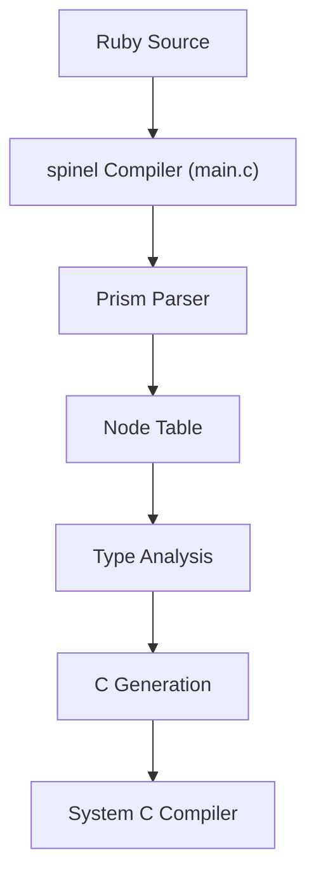

# matz/spinel

> Compiler that turns a subset of Ruby into native executables via C code.

## The problem
Ruby is slow on compute-heavy work, and distributing a script requires installing the interpreter.

## What it actually does
Spinel parses Ruby code with libprism, infers types across the whole program, generates a C file, then calls the system C compiler. The final binary only needs libc and libm. The spin tool manages projects, dependencies and tests. The README claims about 8.5 times faster than Ruby with YJIT on average (geometric mean) over 28 tests, measured by the author. No eval or dynamic metaprogramming.

## How it is wired


## Trying it
```bash
make deps
make
sudo make install
./spinel hello.rb
./hello
spin new myapp && cd myapp
spin run
```

## Cost and gotchas
Free. A C compiler, make and CRuby (to bootstrap) are required. Only a subset of Ruby is accepted and native Windows is best effort. It is not distributed as a gem.

## What it is not
It is not a full replacement for CRuby: no eval, no dynamic method_missing, UTF-8 assumed. Gains depend on the chosen tests.

## Alternatives
No alternative named in the README (it compares against CRuby with and without YJIT).

## For you
Watch: an interesting compilation curiosity, but unrelated to Python or data pipelines; revisit if you write Ruby.
