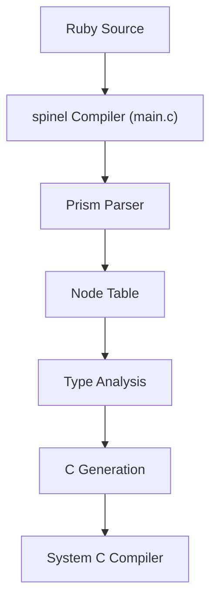

# matz/spinel

> Compilateur qui transforme un sous-ensemble de Ruby en exécutables natifs via du code C.

## Le problème
Ruby est lent sur les calculs intensifs, et distribuer un script suppose d'installer l'interpréteur.

## Ce que ça fait vraiment
Spinel analyse le code Ruby avec libprism, infère les types sur tout le programme, génère un fichier C, puis appelle le compilateur C du système. Le binaire final n'a besoin que de libc et libm. L'outil spin gère projets, dépendances et tests. Le README annonce environ 8,5 fois plus vite que Ruby avec YJIT en moyenne géométrique sur 28 tests, mesurés par l'auteur. Pas d'eval ni de métaprogrammation dynamique.

## Comment c'est branché


## Essayer
```bash
make deps
make
sudo make install
./spinel hello.rb
./hello
spin new myapp && cd myapp
spin run
```

## Coût et pièges
Gratuit. Il faut un compilateur C, make et CRuby pour amorcer. Seul un sous-ensemble de Ruby est accepté et Windows natif est en best effort. Il n'est pas distribué comme gem.

## Ce que ce n'est pas
Ce n'est pas un remplaçant complet de CRuby : sans eval, sans method_missing dynamique, UTF-8 supposé. Les gains dépendent des tests choisis.

## Alternatives
Aucune alternative nommée dans le README (il compare à CRuby avec et sans YJIT).

## Pour toi
À surveiller : curiosité de compilation intéressante, mais sans lien avec Python ou les pipelines data ; à revoir si tu écris du Ruby.

