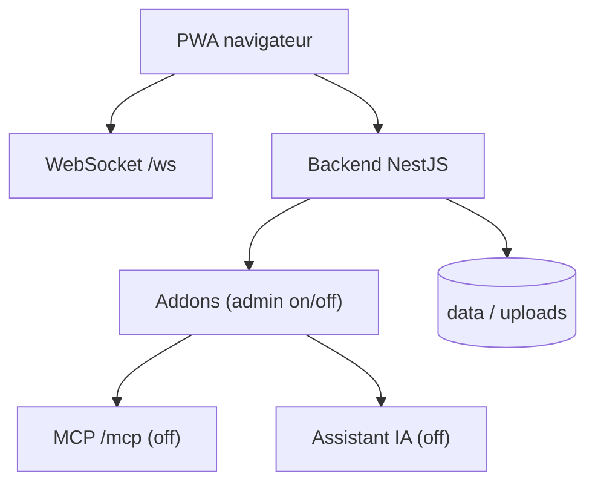

# mauriceboe/TREK

> Self-hosted, collaborative trip planner with map, budget, journal and optional AI assistant.

## The problem
Organizing a trip scatters itineraries, bookings, shared expenses and memories across several tools.

## What it actually does
Day-by-day planning on a real-time map (WebSocket), bookings, shared costs, lists, journal, photo album, leave calendar. Modules can be enabled or not, including an AI assistant and an MCP server, disabled by default. Offline PWA mode, sandboxed plugins, 28 languages. NestJS backend.

## How it is wired


## Trying it
```bash
ENCRYPTION_KEY=$(openssl rand -hex 32) docker run -d --name trek -p 3000:3000 \
  -e ENCRYPTION_KEY=$ENCRYPTION_KEY \
  -e COOKIE_SECURE=false \
  -v ./data:/app/data -v ./uploads:/app/uploads mauriceboe/trek
```

## Cost and gotchas
Free when self-hosted. A reverse proxy with WebSocket support is required in production, HTTPS for the PWA. Place search relies on servers sponsored by dataforest cloud. The AI needs your own key.

## What it is not
Not a data or AI tool: a consumer travel application. The repository dates from March 2026.

## Alternatives
No alternative named in the README.

## For you
Ignore for data/MLOps work: unrelated to your field, except for personal use.
