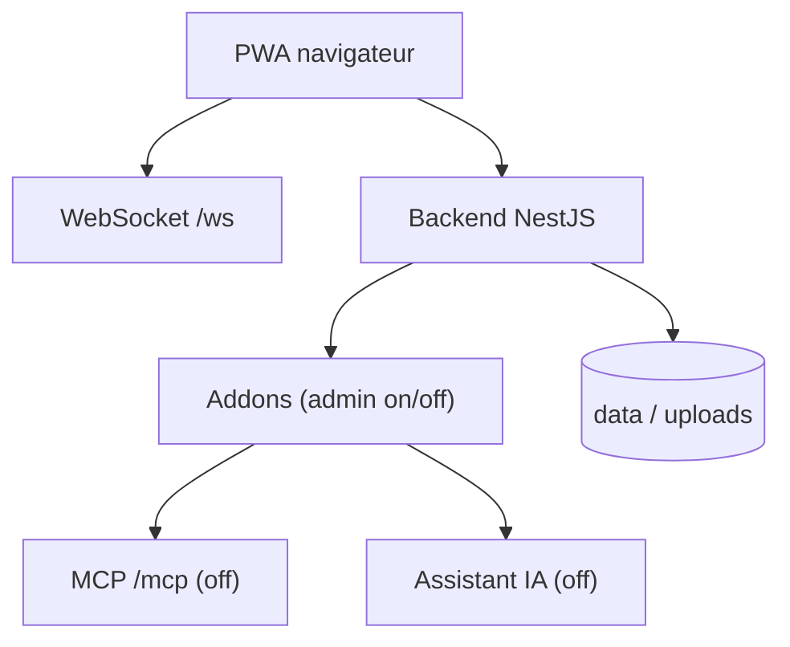

# mauriceboe/TREK

> Planificateur de voyages auto-hébergé, collaboratif, avec carte, budget, journal et assistant IA optionnel.

## Le problème
Organiser un voyage éparpille itinéraires, réservations, frais partagés et souvenirs dans plusieurs outils.

## Ce que ça fait vraiment
Planning par jour sur carte en temps réel (WebSocket), réservations, coûts partagés, listes, journal, album photo, calendrier de congés. Des modules s'activent ou non, dont un assistant IA et un serveur MCP, désactivés par défaut. Mode hors-ligne en PWA, plugins sandboxés, 28 langues. Backend NestJS.

## Comment c'est branché


## Essayer
```bash
ENCRYPTION_KEY=$(openssl rand -hex 32) docker run -d --name trek -p 3000:3000 \
  -e ENCRYPTION_KEY=$ENCRYPTION_KEY \
  -e COOKIE_SECURE=false \
  -v ./data:/app/data -v ./uploads:/app/uploads mauriceboe/trek
```

## Coût et pièges
Gratuit en auto-hébergement. Reverse proxy avec WebSocket requis en production, HTTPS pour la PWA. La recherche de lieux repose sur des serveurs sponsorisés par dataforest cloud. L'IA exige ta propre clé.

## Ce que ce n'est pas
Pas un outil data ou IA : une application grand public de voyage. Le dépôt date de mars 2026.

## Alternatives
Aucune alternative nommée dans le README.

## Pour toi
À ignorer pour le travail data/MLOps : sans rapport avec ton métier, sauf usage personnel.

