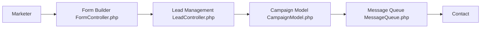

# mautic/mautic

> Open source, self-hostable marketing automation platform, for marketing teams.

## The problem
Marketing automation tools are SaaS products that lock in your contact data.

## What it actually does
PHP application: contact management, forms, pages, assets, multichannel campaigns, email sending, segmentation, OAuth API, reports. The code shows controllers, a campaign model and an event executor.

## How it is wired


## Trying it
```bash
ddev start
composer install
```

## Cost and gotchas
Free self-hosting, but you must manage Composer, a web server and a database; a hosted trial exists via a form. Code outside a tagged release is "alpha" according to the README, with a risk of data loss.

## What it is not
Not a managed service: updates and backups are your responsibility. Not an AI or data science tool.

## Alternatives
No alternative named in the README.

## For you
Keep an eye on it: useful if you have to provide a self-hosted marketing building block, but outside your core data/AI work.
