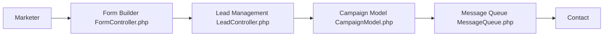

# mautic/mautic

> Plateforme open source d'automatisation marketing auto-hébergeable, pour équipes marketing.

## Le problème
Les outils d'automatisation marketing sont des SaaS qui verrouillent tes données de contacts.

## Ce que ça fait vraiment
Application PHP : gestion de contacts, formulaires, pages, assets, campagnes multicanal, envoi d'e-mails, segmentation, API OAuth, rapports. Le code montre des contrôleurs, un modèle de campagne et un exécuteur d'événements.

## Comment c'est branché


## Essayer
```bash
ddev start
composer install
```

## Coût et pièges
Auto-hébergement gratuit, mais Composer, serveur web et base à gérer ; un essai hébergé existe via formulaire. Le code hors version taguée est « alpha » selon le README, avec risque de perte de données.

## Ce que ce n'est pas
Pas un service géré : mises à jour et sauvegardes sont à ta charge. Pas d'outil d'IA ou de data science.

## Alternatives
Aucune alternative nommée dans le README.

## Pour toi
À surveiller : utile si tu dois fournir une brique marketing auto-hébergée, mais hors cœur de métier data/IA.

