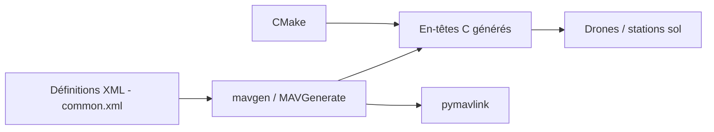

# mavlink/mavlink

> Lightweight message protocol for drones and ground stations, with a multi-language code generator.

## The problem
Components from different manufacturers must exchange telemetry and commands over low-bandwidth links.

## What it actually does
Message definitions in XML ("dialects" such as `common.xml`) are turned by Python tools (`pymavlink.tools.mavgen`) into libraries in several languages, including header-only C headers optimized for low memory. The protocol exists in versions 1.0 and 2.0. The repository also contains C/C++ examples, a CMake integration and the documentation system.

## How it is wired


## Trying it
```bash
sudo apt install python3-pip
git clone https://github.com/mavlink/mavlink.git --recursive
cd mavlink
python3 -m pip install -r pymavlink/requirements.txt
python3 -m pymavlink.tools.mavgen --lang=C --wire-protocol=2.0 --output=generated/include/mavlink/v2.0 message_definitions/v1.0/common.xml
```

## Cost and gotchas
Free. Clone with `--recursive`. The license is present but not identified by GitHub: read the LICENSE file before embedding the code.

## What it is not
Not flight control software nor a simulator: it is a message format and its generator. The repository does not provide a ground station.

## Alternatives
No alternative named in the README.

## For you
Worth watching: useful only if you deal with drone or robotics telemetry; otherwise out of scope, and the license is to be verified.
