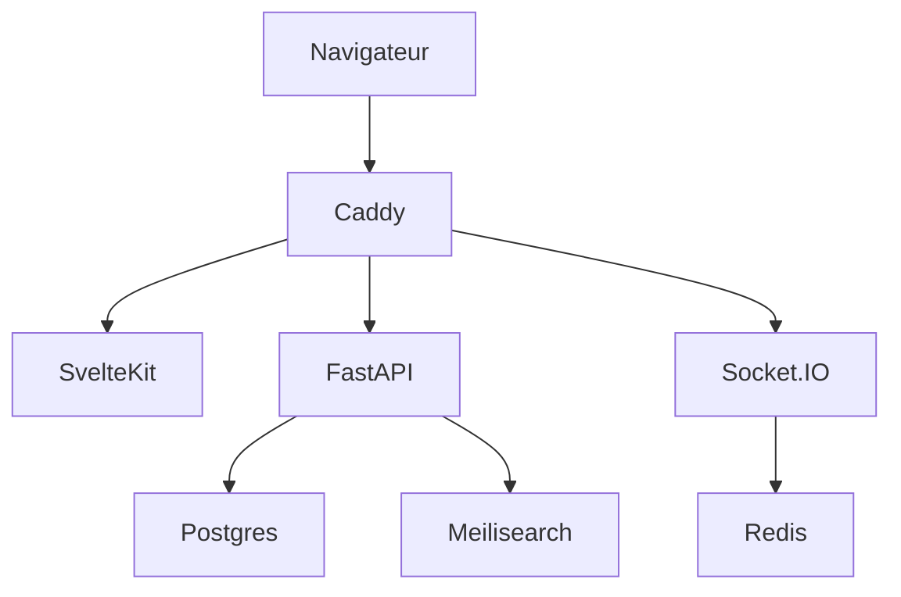

# mawoka-myblock/ClassQuiz

> Open source quiz platform for teachers to have their students play remotely.

## The problem
Popular interactive quiz tools are proprietary, which hinders educational use.

## What it actually does
Teachers create quizzes played live by students. FastAPI, ormar and python-socketio backend, SvelteKit and TailwindCSS frontend. Relies on Postgres, Redis, Meilisearch, Caddy, local or S3 storage, plus Mapbox and hCaptcha (closed services).

## How it is wired


## Trying it
```bash
# Aucune commande dans le README : voir https://classquiz.de/docs/self-host
```

## Cost and gotchas
Stack to host: Postgres, Redis, Meilisearch, Caddy. Depends on Mapbox and hCaptcha. A hosted version exists at classquiz.de (Germany).

## What it is not
Not an advanced pedagogical assessment tool; installation instructions are outside the README.

## Alternatives
No alternative named in the README.

## For you
Educational web application with no data / AI relevance: ignore.
