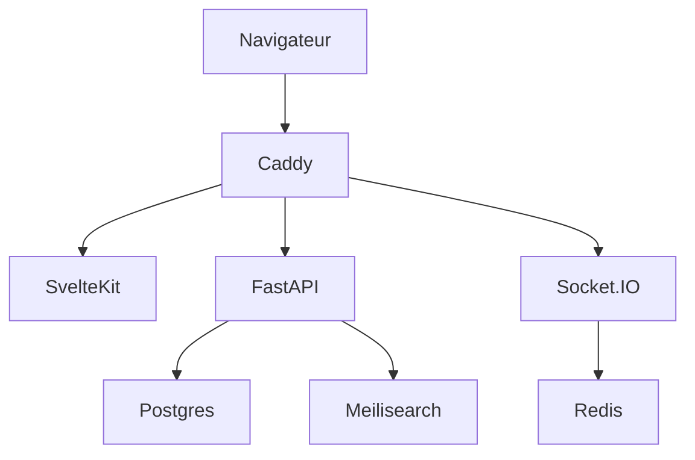

# mawoka-myblock/ClassQuiz

> Plateforme de quiz open source pour que des enseignants fassent jouer leurs élèves à distance.

## Le problème
Les outils de quiz interactifs populaires sont propriétaires, ce qui gêne l'usage éducatif.

## Ce que ça fait vraiment
Les enseignants créent des quiz joués en direct par les élèves. Backend FastAPI, ormar et python-socketio, frontend SvelteKit et TailwindCSS. S'appuie sur Postgres, Redis, Meilisearch, Caddy, un stockage local ou S3, plus Mapbox et hCaptcha (services fermés).

## Comment c'est branché


## Essayer
```bash
# Aucune commande dans le README : voir https://classquiz.de/docs/self-host
```

## Coût et pièges
Pile à héberger : Postgres, Redis, Meilisearch, Caddy. Dépend de Mapbox et hCaptcha. Une version hébergée existe sur classquiz.de (Allemagne).

## Ce que ce n'est pas
Pas un outil d'évaluation pédagogique avancé ; les instructions d'installation sont hors README.

## Alternatives
Aucune alternative nommée dans le README.

## Pour toi
Application éducative web sans enjeu data / IA : à ignorer.

