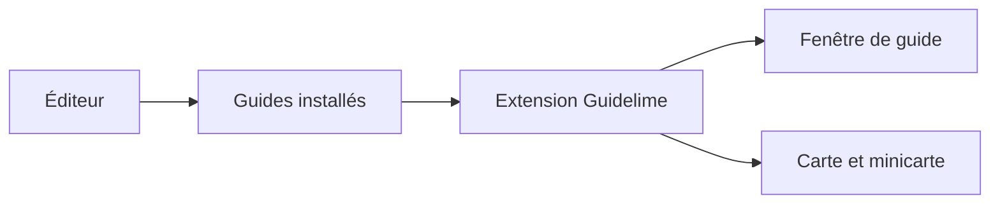

# max-ri/Guidelime

> World of Warcraft Classic addon that displays leveling guides with automatic tracking.

## The problem
Following a leveling guide in game forces you to tick off the steps by hand.

## What it actually does
Displays the steps of a guide and updates them according to quests accepted or completed, items picked up and monsters killed. Shows locations on the map with an arrow. Includes a guide editor and several languages (English, German, French, Russian, Chinese).

## How it is wired
Simplified diagram based on the sheet, no diagram provided.

## Trying it
No command: copy the Guidelime folder into the Addons folder, or go through CurseForge. The `/lime` command reopens the window.

## Cost and gotchas
Does not work on private servers or on Retail. No license declared by the catalog.

## What it is not
Not a general-purpose tool: WoW Classic only. Guides are separate packages.

## Alternatives
No alternative named in the README.

## For you
Ignore: game addon unrelated to data / AI / MLOps.
