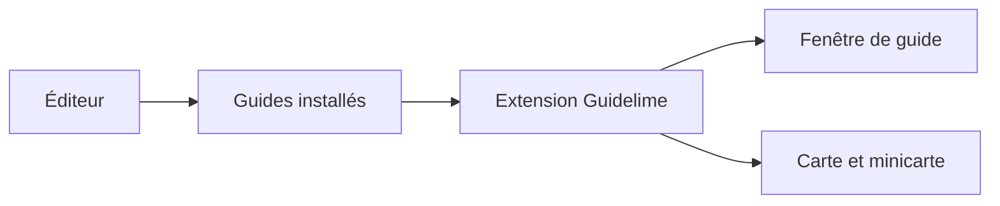

# max-ri/Guidelime

> Extension World of Warcraft Classic qui affiche des guides de montée de niveau avec suivi automatique.

## Le problème
Suivre un guide de niveaux en jeu oblige à cocher les étapes à la main.

## Ce que ça fait vraiment
Affiche les étapes d'un guide et les met à jour selon les quêtes acceptées ou terminées, les objets ramassés et les monstres tués. Montre les lieux sur la carte avec une flèche. Inclut un éditeur de guides et plusieurs langues (anglais, allemand, français, russe, chinois).

## Comment c'est branché
Schéma simplifié d'après la fiche, sans diagramme fourni.

## Essayer
Aucune commande : copier le dossier Guidelime dans le dossier Addons, ou passer par CurseForge. La commande `/lime` rouvre la fenêtre.

## Coût et pièges
Ne fonctionne pas sur serveurs privés ni sur Retail. Aucune licence déclarée par le catalogue.

## Ce que ce n'est pas
Pas un outil général : uniquement WoW Classic. Les guides sont des paquets séparés.

## Alternatives
Aucune alternative nommée dans le README.

## Pour toi
À ignorer : extension de jeu sans rapport avec data / IA / MLOps.

