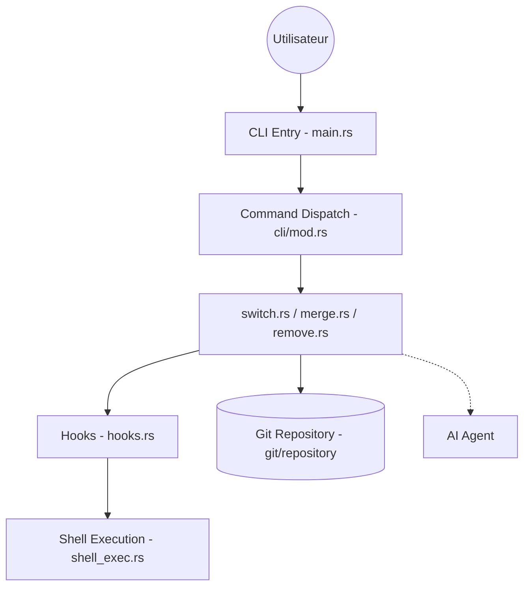

# max-sixty/worktrunk

> CLI that simplifies git worktrees for running several AI agents in parallel.

## The problem
Creating a git worktree means typing the branch name three times and changing directory by hand. Unmanageable with 5 to 10 agents in parallel.

## What it actually does
`wt switch`, `wt list`, `wt remove` address worktrees by branch name, with a path derived from a template. On top of that come hooks (creation, pre- and post-merge), `wt merge` (squash, rebase, merge, cleanup), an interactive picker with CI status, LLM-generated commit messages and build cache sharing on APFS, btrfs and XFS.

## How it is wired


## Trying it
```bash
brew install worktrunk && wt config shell install
wt switch --create feature-auth
wt list
wt merge main
wt switch -x claude -c feature-a -- 'Add user authentication'
```

## Cost and gotchas
Free, installed through Homebrew, Cargo, winget, pacman or conda. On Windows, `wt` conflicts with Windows Terminal: use `git-wt`. LLM commit messages and CI status rely on an external service that you configure.

## What it is not
Not an agent orchestrator: it creates and tidies worktrees, that's all. Not a replacement for git.

## Alternatives
No alternative named in the README.

## For you
Adopt if you run several agents on the same repository: a small tool, light install, immediate gain in workflow.
