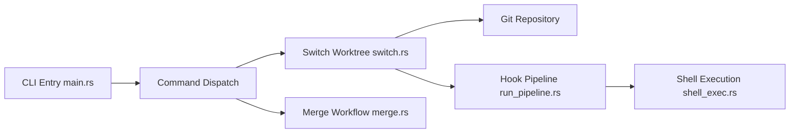

# max-sixty/worktrunk

> CLI Rust qui rend les worktrees git aussi simples que des branches, pour lancer des agents en parallèle.

## Le problème
`git worktree add` est lourd : il faut répéter le nom de branche et changer de répertoire à la main.

## Ce que ça fait vraiment
Trois commandes centrales : `wt switch`, `wt list`, `wt merge`, plus `wt remove`. Chemins calculés par modèle, hooks (création, avant/après fusion), messages de commit générés par LLM, sélecteur interactif avec statut CI, partage de caches de build (APFS, btrfs, XFS), port unique par worktree.

## Comment c'est branché


## Essayer
```bash
brew install worktrunk && wt config shell install
wt switch --create feature-auth
wt switch -x claude -c feature-a -- 'Add user authentication'
wt list
wt merge main
```

## Coût et pièges
Gratuit. Installer l'intégration shell pour que les commandes changent de répertoire. Sous Windows, `wt` entre en conflit avec Windows Terminal : utiliser `git-wt`.

## Ce que ce n'est pas
Pas un agent ni un orchestrateur : il crée seulement les répertoires. Licence non identifiée par GitHub : à vérifier.

## Alternatives
- superset-sh/superset : application graphique, non citée par le README.

## Pour toi
À adopter si tu fais tourner plusieurs agents sur un même dépôt : c'est une couche mince, scriptable, qui évite les collisions de fichiers.

