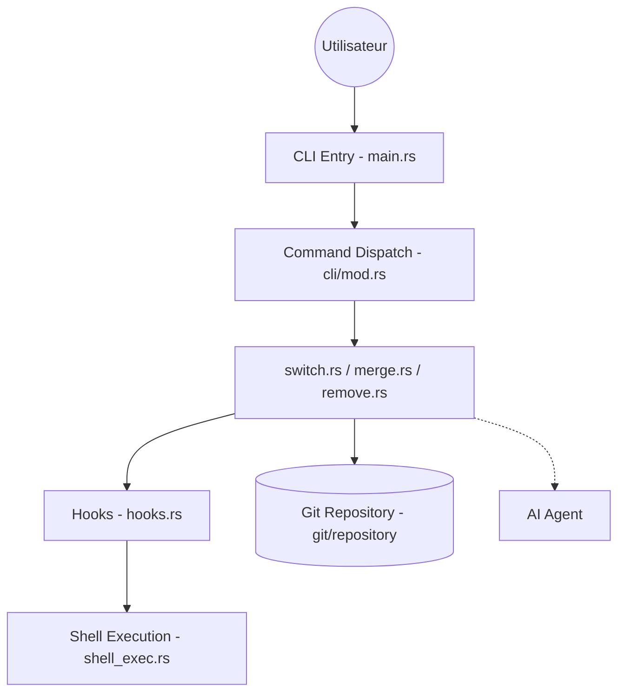

# max-sixty/worktrunk

> CLI qui simplifie les worktrees git pour lancer plusieurs agents IA en parallèle.

## Le problème
Créer un worktree git demande de taper trois fois le nom de branche et de changer de dossier à la main. Ingérable avec 5 à 10 agents en parallèle.

## Ce que ça fait vraiment
`wt switch`, `wt list`, `wt remove` adressent les worktrees par nom de branche, avec un chemin issu d'un modèle. S'y ajoutent des hooks (création, pré et post-fusion), `wt merge` (squash, rebase, fusion, nettoyage), un sélecteur interactif avec statut CI, des messages de commit générés par LLM et le partage de caches de build sur APFS, btrfs et XFS.

## Comment c'est branché


## Essayer
```bash
brew install worktrunk && wt config shell install
wt switch --create feature-auth
wt list
wt merge main
wt switch -x claude -c feature-a -- 'Add user authentication'
```

## Coût et pièges
Gratuit, installation par Homebrew, Cargo, winget, pacman ou conda. Sous Windows, `wt` entre en conflit avec Windows Terminal : utiliser `git-wt`. Les messages de commit LLM et le statut CI reposent sur un service externe configuré par toi.

## Ce que ce n'est pas
Pas un orchestrateur d'agents : il crée et range les worktrees, c'est tout. Pas un remplaçant de git.

## Alternatives
Aucune alternative nommée dans le README.

## Pour toi
À adopter si tu lances plusieurs agents sur un même dépôt : petit outil, installation légère, gain immédiat sur le flux de travail.

