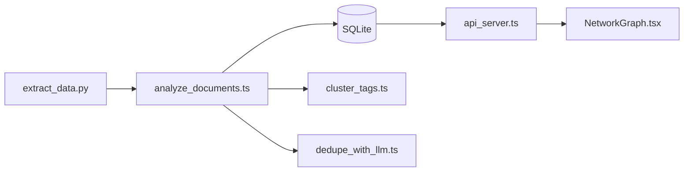

# maxandrews/Epstein-doc-explorer

> Claude pipeline that extracts a relationship graph from legal documents, with an interactive web explorer.

## The problem
A corpus of thousands of documents is unreadable without structured extraction of actors, actions and dates.

## What it actually does
Extracts text from PDFs, has Claude produce triplets (actor, action, target, date, tags) stored in SQLite, groups ~28,000 tags into 30 clusters (K-means, Qwen3 embeddings), and deduplicates entities with an LLM. An Express server feeds a React app with a force graph, a timeline and a document viewer.

## How it is wired


## Trying it
```bash
npm install
cd network-ui && npm install && cd ..
npx tsx api_server.ts
cd network-ui && npm run dev
```

## Cost and gotchas
The analysis uses the Anthropic API (cost tracked in the database). You must supply the source documents. A 91 MB SQLite database is versioned.

## What it is not
Not a verified tool: relationships are extracted by an LLM, so they are error-prone; sensitive subject, handle with care. Last push Nov. 2025.

## Alternatives
No alternative cited in the README.

## For you
Worth watching as an example of an LLM-to-knowledge-graph pipeline, not as a factual source.
