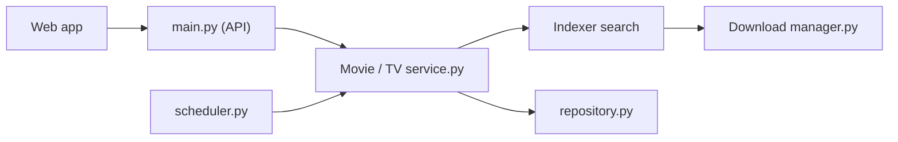

# maxdorninger/MediaManager

> Self-hosted movie and TV series library manager, a unified alternative to the "Arr" stack.

## The problem
Managing series, movies, indexer searches and downloads requires several separate tools.

## What it actually does
A single web interface: metadata lookup (TMDB, TVDB), indexer search, launching downloads through torrent clients, import, notifications and scheduled tasks. OAuth/OIDC authentication. Movie and series flows are separate in the backend.

## How it is wired


## Trying it
```sh
wget -O docker-compose.yaml https://github.com/maxdorninger/MediaManager/releases/latest/download/docker-compose.yaml
mkdir config
wget -O ./config/config.toml https://github.com/maxdorninger/MediaManager/releases/latest/download/config.example.toml
docker compose up -d
```

## Cost and gotchas
Docker and a config.toml file to edit. You need indexers and download clients; the content you fetch is your own legal responsibility.

## What it is not
Not a media player. AGPL license: obligations apply if you offer the service to third parties.

## Alternatives
The "Arr" stack, cited as a point of comparison.

## For you
Home hobby with no link to data/AI: ignore.
