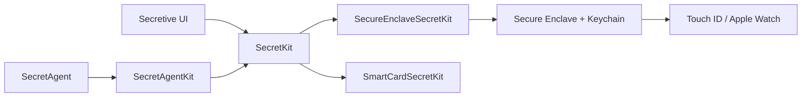

# maxgoedjen/secretive

> macOS application that stores SSH keys in the Secure Enclave, for developers on Mac.

## The problem
An SSH key on disk can be copied by malware; file permissions alone are not enough.

## What it actually does
Keys are created in the Secure Enclave and cannot be exported from it. They can require Touch ID or Apple Watch before each access, and the app notifies on each use. A background agent serves the keys to SSH, with separate Swift libraries for the Secure Enclave and for smart cards (older Macs). Builds are produced by GitHub Actions with attestation since version 3.0.

## How it is wired


## Trying it
```bash
brew install secretive
```
Otherwise, download the latest version from the Releases page.

## Cost and gotchas
Free. Keys cannot be backed up or transferred: on a new Mac, you have to create new ones. When building it yourself, keep the same bundle ID, otherwise the Keychain will not find the keys.

## What it is not
It is not a general secrets manager, nor a cross-platform solution: macOS only. Nor is it a vault shareable across a team.

## Alternatives
The README cites sekey as a source of inspiration; it does not present it as an alternative to prefer.

## For you
Adopt if you SSH into GPU or deployment servers from a Mac: the key can no longer leak by file copy, at minimal installation cost.
