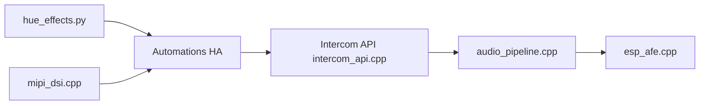

# maxi1134/Home-Assistant-Config

> Personal Home Assistant configuration with documentation and ESPHome intercom firmware.

## The problem
See how an individual structures a connected home (Zigbee, Z-Wave, indoor localization, voice assistant).

## What it actually does
Configuration repository: automations, hardware, software, network and VLANs, Zigbee devices, localization via ESPresense, a voice assistant guide with Ollama and ESPHome. The sampled code mostly concerns two generations of ESP intercom (ESP audio stack, legacy UDP audio) and a few utilities.

## How it is wired

## Trying it
No command documented in the README.

## Cost and gotchas
Free, but hardware (Zigbee/Z-Wave dongles, ESP) is at your expense. No license.

## What it is not
Not a reusable integration: a personal configuration to adapt.

## Alternatives
No alternative named in the README.

## For you
Worth watching: a source of ideas for a local voice assistant (Ollama, ESPHome), not a project to install as is.
