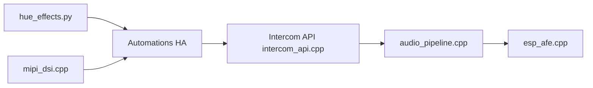

# maxi1134/Home-Assistant-Config

> Configuration personnelle Home Assistant avec documentation et firmware ESPHome d'interphone.

## Le problème
Voir comment un particulier structure une maison connectée (Zigbee, Z-Wave, localisation intérieure, assistant vocal).

## Ce que ça fait vraiment
Dépôt de configuration : automatisations, matériel, logiciel, réseau et VLAN, appareils Zigbee, localisation par ESPresense, guide d'assistant vocal avec Ollama et ESPHome. Le code échantillonné porte surtout sur deux générations d'interphone ESP (pile audio ESP, audio UDP hérité) et quelques utilitaires.

## Comment c'est branché

## Essayer
Aucune commande documentée dans le README.

## Coût et pièges
Gratuit, mais matériel (clés Zigbee/Z-Wave, ESP) à ta charge. Aucune licence.

## Ce que ce n'est pas
Pas une intégration réutilisable : une configuration personnelle à adapter.

## Alternatives
Aucune alternative nommée dans le README.

## Pour toi
À surveiller : source d'idées pour un assistant vocal local (Ollama, ESPHome), pas un projet à installer tel quel.

