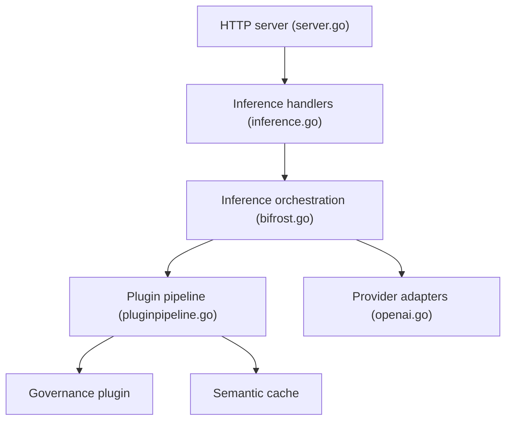

# maximhq/bifrost

> AI gateway in Go that unifies more than twenty providers behind an OpenAI-compatible API, with automatic failover.

## The problem
Each LLM provider has its own API, quotas and outages; switching or spreading the load costs code.

## What it actually does
HTTP gateway (or Go SDK) that normalizes calls to OpenAI, Anthropic, Bedrock, Vertex and others, with failover between providers, distribution across keys, semantic cache, MCP gateway, plugins, governance (budgets, virtual keys, limits) and Prometheus metrics. Web configuration interface. Optional persistence (SQLite, Postgres, ClickHouse, vector stores). The README claims 11 µs of overhead at 5,000 requests per second.

## How it is wired


## Trying it
```bash
npx -y @maximhq/bifrost
docker run -p 8080:8080 maximhq/bifrost
curl -X POST http://localhost:8080/v1/chat/completions \
  -H "Content-Type: application/json" \
  -d '{"model": "openai/gpt-4o-mini", "messages": [{"role": "user", "content": "Hello, Bifrost!"}]}'
```

## Cost and gotchas
Provider keys and their billing are at your expense. Clustering, guardrails, adaptive load balancing and the MCP gateway are described as reserved for enterprise deployments. More than 1,200 open issues.

## What it is not
Not a model provider. The performance figures are the vendor's own, measured on its machines.

## Alternatives
LiteLLM is cited as an embeddable SDK; no other alternative named.

## For you
Worth watching: useful for centralizing a team's LLM calls, but some key features are paid.
