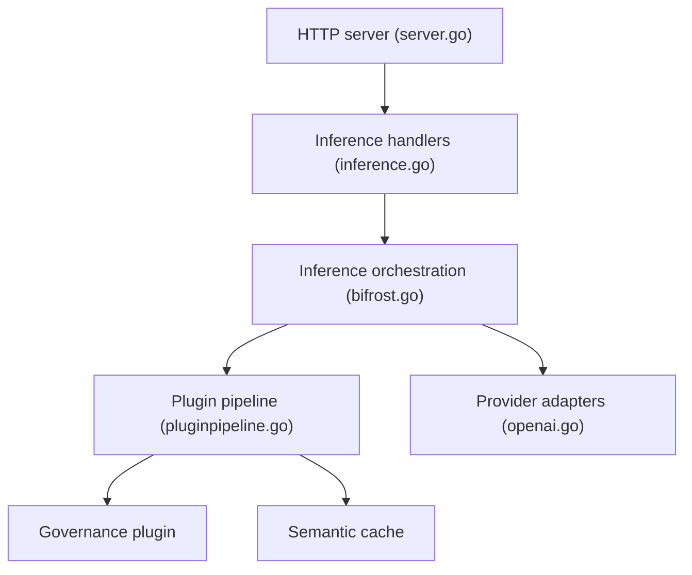

# maximhq/bifrost

> Passerelle IA en Go qui unifie plus de vingt fournisseurs derrière une API compatible OpenAI, avec bascule automatique.

## Le problème
Chaque fournisseur de LLM a son API, ses quotas et ses pannes ; changer ou répartir la charge coûte du code.

## Ce que ça fait vraiment
Passerelle HTTP (ou SDK Go) qui normalise les appels vers OpenAI, Anthropic, Bedrock, Vertex et d'autres, avec bascule entre fournisseurs, répartition entre clés, cache sémantique, passerelle MCP, plugins, gouvernance (budgets, clés virtuelles, limites) et métriques Prometheus. Interface web de configuration. Persistance optionnelle (SQLite, Postgres, ClickHouse, magasins vectoriels). Le README annonce 11 µs de surcharge à 5 000 requêtes par seconde.

## Comment c'est branché


## Essayer
```bash
npx -y @maximhq/bifrost
docker run -p 8080:8080 maximhq/bifrost
curl -X POST http://localhost:8080/v1/chat/completions \
  -H "Content-Type: application/json" \
  -d '{"model": "openai/gpt-4o-mini", "messages": [{"role": "user", "content": "Hello, Bifrost!"}]}'
```

## Coût et pièges
Les clés des fournisseurs et leur facturation restent à ta charge. Clustering, garde-fous, équilibrage adaptatif et passerelle MCP sont décrits comme réservés aux déploiements entreprise. Plus de 1 200 issues ouvertes.

## Ce que ce n'est pas
Pas un fournisseur de modèles. Les chiffres de performance sont ceux de l'éditeur, mesurés sur ses machines.

## Alternatives
LiteLLM est cité comme SDK intégrable ; aucune autre alternative nommée.

## Pour toi
À surveiller : utile pour centraliser les appels LLM d'une équipe, mais certaines fonctions clés sont payantes.

