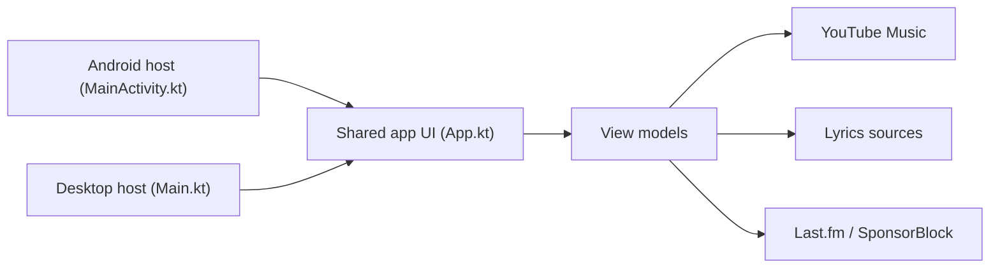

# maxrave-dev/SimpMusic

> Free YouTube Music client for Android and desktop, in Compose Multiplatform, with lyrics and listening analytics.

## The problem
The official app imposes ads and limits; an alternative client plays YouTube Music without ads.

## What it actually does
Compose Multiplatform application with Android (`MainActivity.kt`) and desktop (`Main.kt`) hosts, shared UI (`App.kt`). Background playback, offline cache, equalizer, word-by-word lyrics, yearly recap, widgets, SponsorBlock, Return YouTube Dislike, Last.fm, Cast, Android Auto. The data comes from an unofficial YouTube Music API. Announced architecture: clean architecture with MVVM.

## How it is wired

## Trying it
The README contains no commands, only downloads (Windows: unzip then `install.bat`, macOS: `.dmg`, Linux: `.AppImage`). No documented command.

## Cost and gotchas
Free. The application is in beta and crashes, says the author. The Full version sends crashes to Sentry; the FOSS version does not. Lyrics translation: OpenAI or Gemini key at your expense.

## What it is not
Not an official or stable service: playback errors are normal according to the author. Lyrics may be wrong.

## Alternatives
- Metrolist: compatible client for shared listening.
- InnerTune: cited source of inspiration.

## For you
Ignore: consumer music player, unstable, unrelated to your field.
