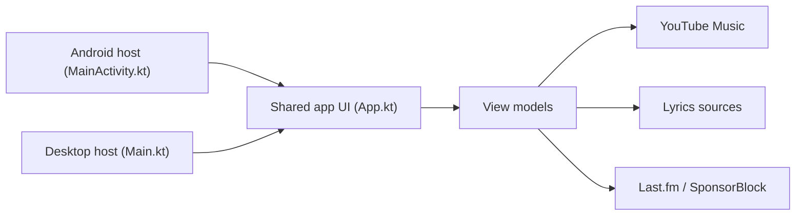

# maxrave-dev/SimpMusic

> Client libre YouTube Music pour Android et bureau, en Compose Multiplatform, avec paroles et analyses d'écoute.

## Le problème
L'application officielle impose pubs et limites ; un client alternatif lit YouTube Music sans publicité.

## Ce que ça fait vraiment
Application Compose Multiplatform avec hôtes Android (`MainActivity.kt`) et bureau (`Main.kt`), interface partagée (`App.kt`). Lecture en arrière-plan, cache hors-ligne, égaliseur, paroles mot par mot, résumé annuel, widgets, SponsorBlock, Return YouTube Dislike, Last.fm, Cast, Android Auto. Les données viennent d'une API YouTube Music non officielle. Architecture annoncée : clean architecture avec MVVM.

## Comment c'est branché

## Essayer
Le README ne contient aucune commande, seulement des téléchargements (Windows : décompresser puis `install.bat`, macOS : `.dmg`, Linux : `.AppImage`). Aucune commande documentée.

## Coût et pièges
Gratuit. L'application est en bêta et plante, dit l'auteur. La version Full envoie les plantages à Sentry ; la version FOSS non. Traduction des paroles : clé OpenAI ou Gemini à ta charge.

## Ce que ce n'est pas
Pas un service officiel ni stable : les erreurs de lecture sont normales selon l'auteur. Les paroles peuvent être fausses.

## Alternatives
- Metrolist : client compatible pour l'écoute partagée.
- InnerTune : source d'inspiration citée.

## Pour toi
Ignorer : lecteur de musique grand public, instable, sans rapport avec ton métier.

