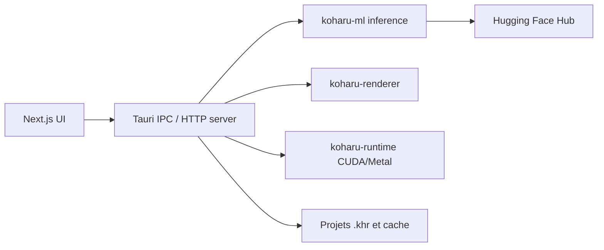

# mayocream/koharu

> A desktop application that translates manga locally: detection, OCR, inpainting and LLM.

## The problem
Translating a manga page by page by hand means erasing the text, retyping it and recomposing it.

## What it actually does
Selectable pipeline: detection of bubbles and masks, OCR (PaddleOCR VL, Manga OCR...), erasing by inpainting (FLUX.2 Klein, LaMa, AOT GAN), translation by a local GGUF LLM (Gemma, Qwen, Ministral, LFM) or remote providers (OpenAI, Gemini, Claude, DeepL...). WebGPU canvas for retouching, PSD export by layers, agent mode.

## How it is wired


## Trying it
```bash
winget install koharu
brew install --cask koharu
bun install
bun dev
```
Dev prerequisites: Rust, Bun, LLVM. The README is truncated in places (incomplete launch section).

## Cost and gotchas
Free locally; a CUDA, ROCm, Metal or Vulkan GPU is recommended, CPU is much slower. Models are downloaded from Hugging Face. Remote providers are billed to you.

## What it is not
Not an online service: everything runs on your machine. Not for use outside manga. "Uncensored" models are offered, to be checked against your own rules.

## Alternatives
No alternative named in the README.

## For you
Watch: a complete example of a local ML chain (detection, OCR, inpainting, quantized LLM) worth reading, with no obvious business use.
