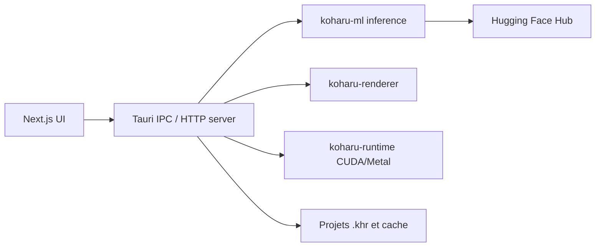

# mayocream/koharu

> Une application de bureau qui traduit les mangas en local : détection, OCR, inpainting et LLM.

## Le problème
Traduire un manga page par page à la main oblige à effacer le texte, le retaper et le recomposer.

## Ce que ça fait vraiment
Pipeline sélectionnable : détection des bulles et masques, OCR (PaddleOCR VL, Manga OCR…), effacement par inpainting (FLUX.2 Klein, LaMa, AOT GAN), traduction par LLM local GGUF (Gemma, Qwen, Ministral, LFM) ou fournisseurs distants (OpenAI, Gemini, Claude, DeepL…). Canvas WebGPU pour retouche, export PSD par calques, mode agent.

## Comment c'est branché


## Essayer
```bash
winget install koharu
brew install --cask koharu
bun install
bun dev
```
Prérequis dev : Rust, Bun, LLVM. Le README est tronqué par endroits (section de lancement incomplète).

## Coût et pièges
Gratuit en local ; GPU CUDA, ROCm, Metal ou Vulkan recommandé, CPU nettement plus lent. Modèles téléchargés depuis Hugging Face. Fournisseurs distants facturés chez toi.

## Ce que ce n'est pas
Pas un service en ligne : tout tourne chez toi. Pas pour un usage hors manga. Des modèles « uncensored » sont proposés, à vérifier selon tes règles.

## Alternatives
Aucune alternative nommée dans le README.

## Pour toi
Surveiller : exemple complet de chaîne ML locale (détection, OCR, inpainting, LLM quantifié) intéressant à lire, sans usage métier évident.

