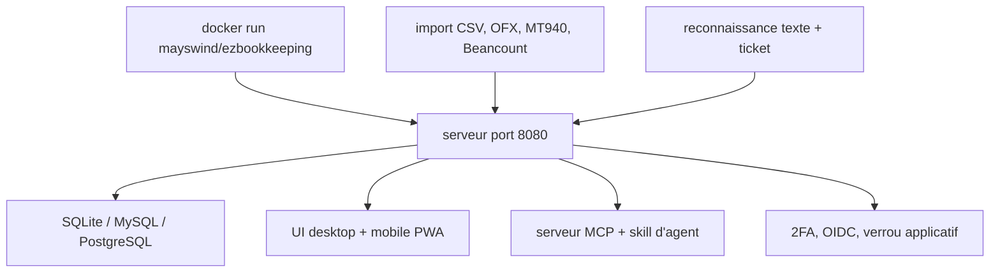

# mayswind/ezbookkeeping

> Lightweight self-hosted personal accounting application with multi-format import.

## The problem
Personal finance applications are either cloud-based, heavy, or unable to swallow legacy bank formats.
Analyzing your spending means exporting to a spreadsheet.

## What it actually does
It records transactions with two-level accounts and categories, image attachments, map geolocation and scheduled transactions.
Import covers CSV, Excel, OFX, QFX, QIF, IIF, Camt.052, Camt.053, MT940, GnuCash, Firefly III and Beancount, with column mapping, rules and custom scripts.
Analysis goes through built-in charts or custom queries with your own dimensions; the UI is distinct on mobile and desktop, installable as a PWA.
On the AI side: text and receipt image recognition, an MCP server, an agent skill and CLI scripts for integration.

## How it is wired


## Trying it
```bash
docker run -p8080:8080 mayswind/ezbookkeeping
./build.sh package -o ezbookkeeping.tar.gz
./build.sh docker
```

## Cost and gotchas
Free and frugal: the README claims it runs on NAS and Raspberry Pi, x86, amd64 and ARM.
Documented gotcha: in production you must mount a persistent volume when starting the container, otherwise the data disappears.

## What it is not
It is not an enterprise tool: it is personal accounting, with no multi-entity support or standardized accounting entries.
The AI features are announced but not detailed in the README — no provider, no key, no cost indicated.

## Alternatives
- GnuCash, Firefly III, Beancount: cited as import formats, hence as the tools people migrate from.

## For you
Outside the professional scope; worth noting only for the idea of an MCP server placed on your own personal data.
