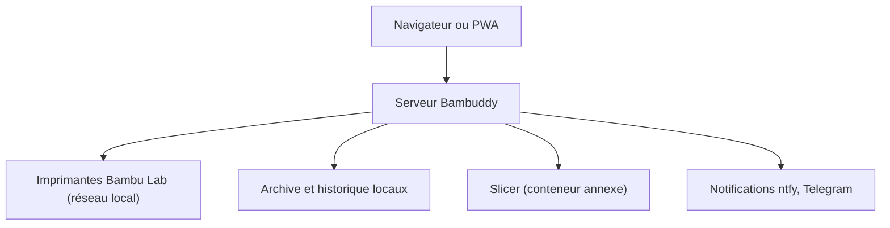

# maziggy/bambuddy

> Self-hosted command center for Bambu Lab 3D printers, from a single machine to a print farm.

## The problem
Controlling one or several Bambu Lab printers without depending on the manufacturer's cloud.

## What it actually does
A web server that connects to printers on the local network: live status, cameras, print archive, queue and scheduling, AMS filament management, server-side slicing, per-group permissions, costs and budgets, remote proxy mode. Optional failure detection via Obico or OctoEverywhere.

## How it is wired
Simplified diagram based on the sheet, no diagram provided.

## Trying it
No command in the supplied part of the README (truncated): a 30-minute demo instance is advertised.

## Cost and gotchas
Free, but heavy to run: Docker, printers' developer mode, access to their code. Prints launched from Bambu Studio to internal storage are not fully archived. AGPL license.

## What it is not
Not a general automation tool: it only targets Bambu Lab. Not a cloud service: everything is on your side.

## Alternatives
- Bambu Studio: the official slicer.
- OrcaSlicer: another slicer that sends the file to the card.

## For you
Ignore: 3D printer fleet management, unrelated to data, AI or MLOps, except as a personal hobby.
