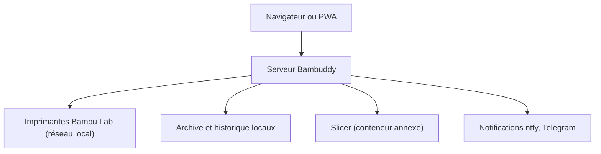

# maziggy/bambuddy

> Centre de commande auto-hébergé pour imprimantes 3D Bambu Lab, d'une machine à une ferme d'impression.

## Le problème
Piloter une ou plusieurs imprimantes Bambu Lab sans dépendre du cloud du fabricant.

## Ce que ça fait vraiment
Serveur web qui se connecte aux imprimantes sur le réseau local : état en direct, caméras, archive des impressions, file d'attente et planification, gestion des filaments AMS, découpe côté serveur, droits par groupe, coûts et budgets, mode proxy distant. Détection d'échecs via Obico ou OctoEverywhere en option.

## Comment c'est branché
Schéma simplifié d'après la fiche, sans diagramme fourni.

## Essayer
Aucune commande dans la partie du README fournie (tronquée) : une instance de démonstration de 30 minutes est annoncée.

## Coût et pièges
Gratuit, mais lourd à exploiter : Docker, mode développeur des imprimantes, accès à leur code. Les impressions lancées depuis Bambu Studio vers la mémoire interne ne sont pas archivées complètement. Licence AGPL.

## Ce que ce n'est pas
Pas un outil général d'automatisation : il ne cible que Bambu Lab. Pas un service cloud : tout est chez toi.

## Alternatives
- Bambu Studio : le slicer officiel.
- OrcaSlicer : autre slicer qui envoie le fichier sur la carte.

## Pour toi
Ignorer : gestion de parc d'imprimantes 3D, sans lien avec la data, l'IA ou le MLOps, sauf loisir personnel.

