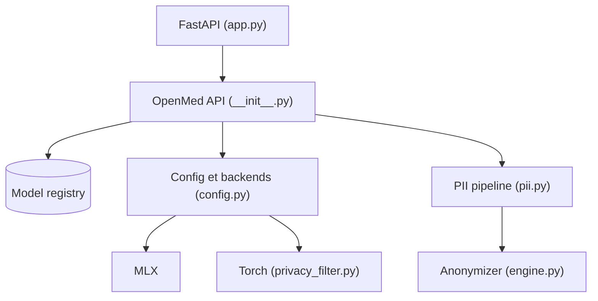

# maziyarpanahi/openmed

> Local library for clinical NER and de-identification of medical text, from Python to iOS and Android.

## The problem
Extracting medical entities and masking patient data without sending the text to a cloud API.

## What it actually does
OpenMed loads models from the catalog (diseases, drugs, anatomy, genes, PII) via Hugging Face, MLX (Apple Silicon), CoreML or ONNX, and returns entities or de-identified text (masking, replacement, hashing, date shifting). A PII pipeline adds span merging, per-country rules and quality checks. A FastAPI REST service, agent skills, a Swift package, an Android library and a browser export are provided.

## How it is wired


## Trying it
```bash
pip install --upgrade "openmed[hf]"
pip install --upgrade "openmed[hf,service]"
python -m openmed.service.logging --host 0.0.0.0 --port 8080
python examples/v30_clinical_brief.py
```

## Cost and gotchas
Free SDK under Apache-2.0, but model and dataset licenses vary: check them one by one. Model downloads go through the network. The README states that using the SDK does not establish any HIPAA compliance.

## What it is not
Not a clinical validation: the README demos use synthetic test components. Not a replacement for expert review before real de-identification use.

## Alternatives
No alternative cited in the README.

## For you
Worth watching if you process clinical texts: the local building block looks solid on paper, but 548 open issues, a single maintainer and heterogeneous model licenses call for validation before adoption.
