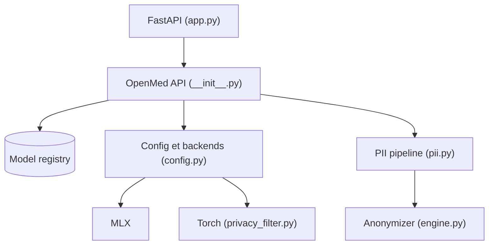

# maziyarpanahi/openmed

> Bibliothèque locale de NER clinique et de dé-identification de textes médicaux, du Python à iOS et Android.

## Le problème
Extraire des entités médicales et masquer des données patient sans envoyer le texte à une API cloud.

## Ce que ça fait vraiment
OpenMed charge des modèles du catalogue (maladies, médicaments, anatomie, gènes, PII) via Hugging Face, MLX (Apple Silicon), CoreML ou ONNX, et rend entités ou texte dé-identifié (masquage, remplacement, hash, décalage de dates). Un pipeline PII ajoute fusion de spans, règles par pays et contrôles qualité. Un service REST FastAPI, des skills pour agents, un paquet Swift, une bibliothèque Android et un export navigateur sont fournis.

## Comment c'est branché


## Essayer
```bash
pip install --upgrade "openmed[hf]"
pip install --upgrade "openmed[hf,service]"
python -m openmed.service.logging --host 0.0.0.0 --port 8080
python examples/v30_clinical_brief.py
```

## Coût et pièges
SDK gratuit en Apache-2.0, mais les licences des modèles et jeux de données varient : à vérifier un par un. Le téléchargement des modèles passe par le réseau. Le README précise que l'usage du SDK n'établit aucune conformité HIPAA.

## Ce que ce n'est pas
Pas une validation clinique : les démos du README utilisent des composants de test synthétiques. Pas un remplaçant d'une revue d'expert avant un usage réel de dé-identification.

## Alternatives
Aucune alternative citée dans le README.

## Pour toi
À surveiller si tu traites des textes cliniques : la brique locale est solide sur le papier, mais 548 issues ouvertes, un seul porteur et des licences de modèles hétérogènes demandent une validation avant adoption.

