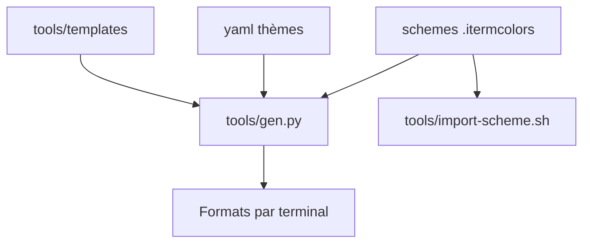

# mbadolato/iTerm2-Color-Schemes

> Collection of hundreds of color themes for iTerm2, with ports to many terminals and editors.

## The problem
Choosing and installing a readable terminal theme means hunting for color values, terminal by terminal.

## What it actually does
`.itermcolors` files and YAML sources, converted by `tools/gen.py` to Terminal, Konsole, PuTTY, Alacritty, Ghostty, Windows Terminal, Vim, VS Code and others. Screenshots are sorted into dark and light themes. A `licenses.yml` file records the license of each theme.

## How it is wired



## Trying it
```bash
tools/import-scheme.sh schemes/*
tools/import-scheme.sh 'SpaceGray Eighties'
python3 tools/gen.py -s "Your Theme Name"
```

## Cost and gotchas
Free. The repo is heavy (hundreds of screenshots and files). The repo license is not identified by GitHub, and some themes are marked `unknown` or `nonfree`: `gen.py --redistributable` only generates redistributable themes. iTerm2 must be restarted after import.

## What it is not
It is not a program or a single theme: it is a catalog. The README does not guarantee the license of each theme.

## Alternatives
No alternative named in the README, which cites the Gogh project for the YAML format.

## For you
Adopt for a comfortable terminal theme in a few minutes; check the license if you redistribute.
