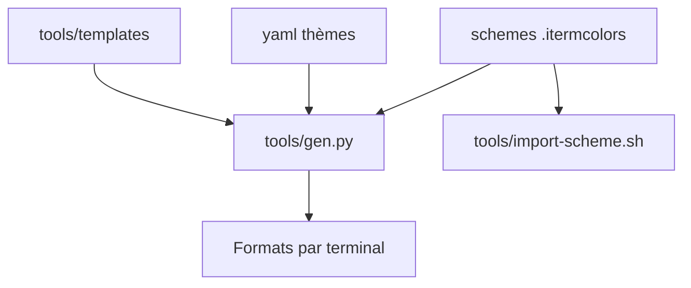

# mbadolato/iTerm2-Color-Schemes

> Collection de centaines de thèmes de couleurs pour iTerm2, avec portages vers de nombreux terminaux et éditeurs.

## Le problème
Choisir et installer un thème de terminal lisible demande de chercher les valeurs de couleur, terminal par terminal.

## Ce que ça fait vraiment
Des fichiers `.itermcolors` et des sources YAML, convertis par `tools/gen.py` vers Terminal, Konsole, PuTTY, Alacritty, Ghostty, Windows Terminal, Vim, VS Code et d'autres. Des captures d'écran sont classées en thèmes sombres et clairs. Un fichier `licenses.yml` consigne la licence de chaque thème.

## Comment c'est branché



## Essayer
```bash
tools/import-scheme.sh schemes/*
tools/import-scheme.sh 'SpaceGray Eighties'
python3 tools/gen.py -s "Your Theme Name"
```

## Coût et pièges
Gratuit. Le dépôt est lourd (centaines de captures et de fichiers). Licence du dépôt non identifiée par GitHub, et certains thèmes sont marqués `unknown` ou `nonfree` : `gen.py --redistributable` ne génère que les thèmes redistribuables. Il faut redémarrer iTerm2 après import.

## Ce que ce n'est pas
Ce n'est pas un programme ni un thème unique : c'est un catalogue. Le README ne garantit pas la licence de chaque thème.

## Alternatives
Aucune alternative nommée dans le README, qui cite le projet Gogh pour le format YAML.

## Pour toi
À adopter pour un thème de terminal confortable en quelques minutes ; vérifie la licence si tu redistribues.

