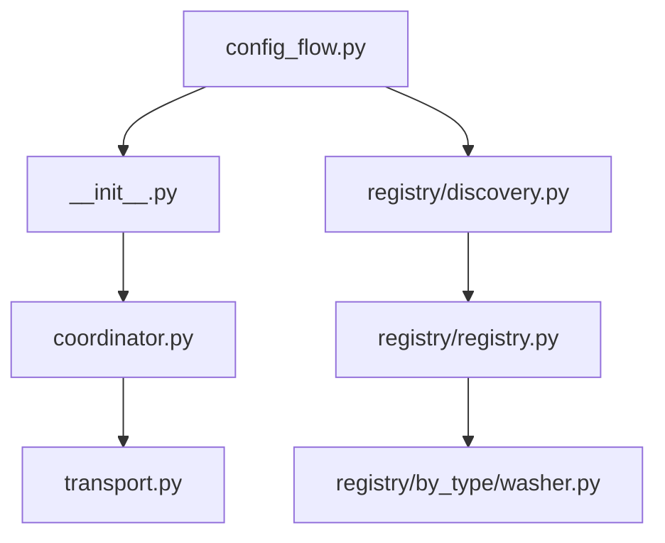

# mbillow/localthings

> Home Assistant integration that controls Samsung SmartThings devices locally, with no cloud account.

## The problem
Connected Samsung devices go through the SmartThings cloud, which adds latency, dependence on the Internet and data leakage.

## What it actually does
- Discovers the device from its IP address and creates the matching Home Assistant entities.
- Speaks OCF over CoAP on DTLS, with Observe for pushed updates, otherwise polls every 30 seconds.
- A declarative table per device type, tested on more than 90 real captures.
- Supports washing machines, refrigerators, air conditioners, ovens and others, with anonymized diagnostics.

## How it is wired


## Trying it
```bash
# README : installer via HACS (Integrations > LocalThings > Download),
# ou copier custom_components/localthings/ dans la configuration de Home Assistant.
# Puis redémarrer et ajouter l'intégration avec l'adresse IP de l'appareil.
```

## Cost and gotchas
Home Assistant and a Samsung device required; the first addition contacts Samsung once. Do not remove the device from SmartThings: it resets itself.

## What it is not
Not independent of Samsung: the device keeps its own cloud connection. Some models require a pre-shared key that the tool cannot obtain.

## Alternatives
No alternative named in the README.

## For you
Ignore: home automation, unrelated to data, AI or MLOps work, unless you already own these devices.
