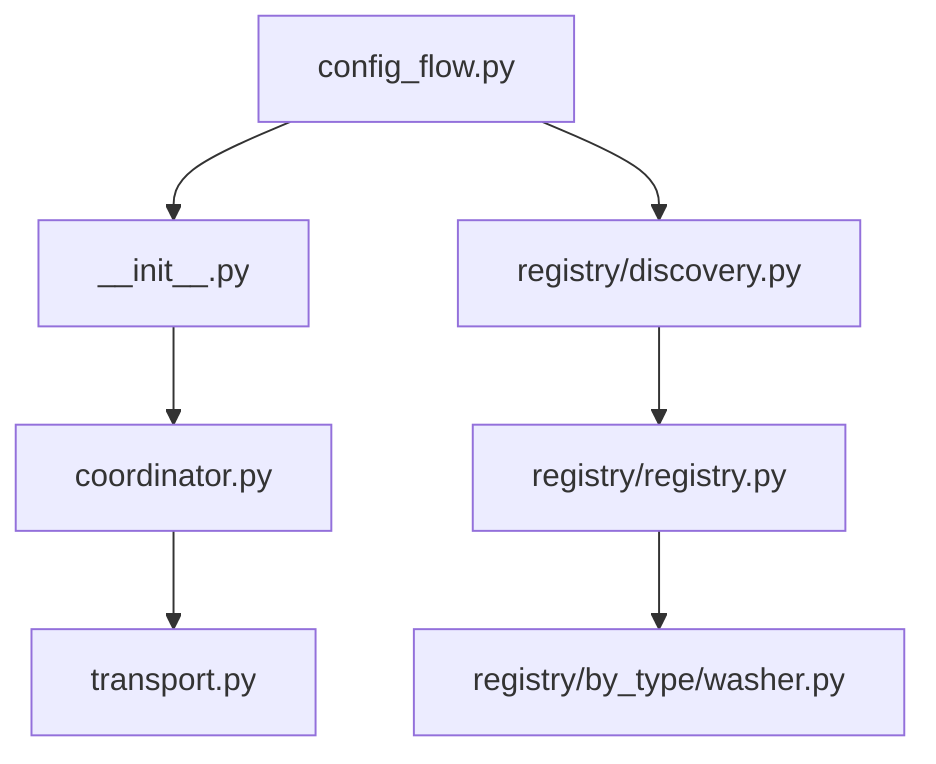

# mbillow/localthings

> Intégration Home Assistant qui pilote les appareils Samsung SmartThings en local, sans compte cloud.

## Le problème
Les appareils Samsung connectés passent par le cloud SmartThings, ce qui ajoute délai, dépendance à Internet et fuite de données.

## Ce que ça fait vraiment
- Découvre l'appareil à partir de son adresse IP et crée les entités Home Assistant adaptées.
- Parle OCF en CoAP sur DTLS, avec Observe pour les mises à jour poussées, sinon relève toutes les 30 secondes.
- Une table déclarative par type d'appareil, testée sur plus de 90 captures réelles.
- Supporte lave-linge, réfrigérateurs, climatiseurs, fours et d'autres, avec diagnostics anonymisés.

## Comment c'est branché


## Essayer
```bash
# README : installer via HACS (Integrations > LocalThings > Download),
# ou copier custom_components/localthings/ dans la configuration de Home Assistant.
# Puis redémarrer et ajouter l'intégration avec l'adresse IP de l'appareil.
```

## Coût et pièges
Home Assistant et un appareil Samsung requis ; le premier ajout contacte Samsung une fois. Ne pas retirer l'appareil de SmartThings : il se réinitialise.

## Ce que ce n'est pas
Pas indépendant de Samsung : l'appareil garde sa propre connexion cloud. Certains modèles exigent une clé pré-partagée que l'outil ne peut pas obtenir.

## Alternatives
Aucune alternative nommée dans le README.

## Pour toi
À ignorer : domotique de maison, sans lien avec un travail data, IA ou MLOps, sauf si tu possèdes déjà ces appareils.

