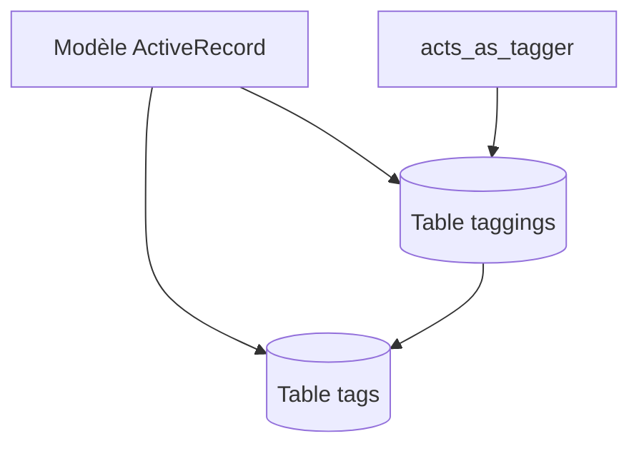

# mbleigh/acts-as-taggable-on

> Ruby on Rails gem for adding tags to models, with multiple contexts.

## The problem
Adding tags to ActiveRecord models, with several categories of tags, takes a lot of code.

## What it actually does
The gem adds `acts_as_taggable_on` to a model: tag lists per context, `tagged_with` search (all, any, exclusion, wildcards), tag owners, multi-tenancy, tag cloud, popular tags and related objects. It is configurable (lowercase, delimiter, tables). It requires Ruby 3.3+ and Rails 8.0 or 8.1 for recent versions.

## How it is wired
Simplified diagram based on the sheet, no diagram provided.


## Trying it
```bash
bundle
rake acts_as_taggable_on_engine:install:migrations
rake db:migrate
```
Gemfile: `gem 'acts-as-taggable-on'`

## Cost and gotchas
Free. MySQL pitfall with special characters (`force_binary_collation`) and SQLite with multibyte.

## What it is not
Not a recommendation or classification engine: it is tag storage. Nothing to do with Python despite the use of the mandated list.

## Alternatives
No alternative named in the README.

## For you
Ignore: Ruby on Rails ecosystem, with no direct use for a data/AI/MLOps profile.
