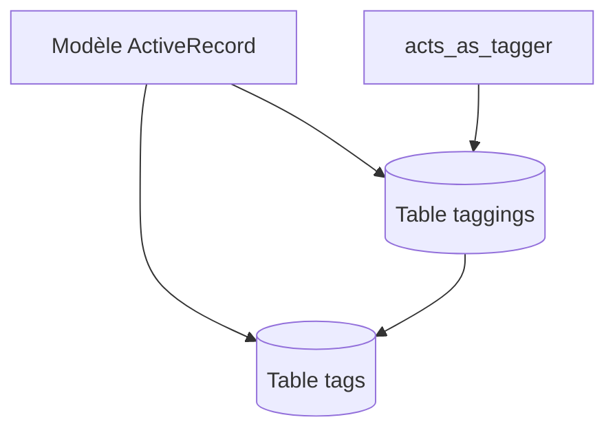

# mbleigh/acts-as-taggable-on

> Gem Ruby on Rails pour ajouter des étiquettes à des modèles, avec contextes multiples.

## Le problème
Ajouter des tags à des modèles ActiveRecord, avec plusieurs catégories d'étiquettes, demande beaucoup de code.

## Ce que ça fait vraiment
Le gem ajoute `acts_as_taggable_on` à un modèle : listes de tags par contexte, recherche `tagged_with` (tous, un seul, exclusion, jokers), propriétaires de tags, multi-tenant, nuage de tags, tags populaires et objets liés. Il se configure (minuscules, délimiteur, tables). Il requiert Ruby 3.3+ et Rails 8.0 ou 8.1 pour les versions récentes.

## Comment c'est branché
Schéma simplifié d'après la fiche, sans diagramme fourni.


## Essayer
```bash
bundle
rake acts_as_taggable_on_engine:install:migrations
rake db:migrate
```
Gemfile : `gem 'acts-as-taggable-on'`

## Coût et pièges
Gratuit. Piège MySQL sur les caractères spéciaux (`force_binary_collation`) et SQLite sur le multi-octet.

## Ce que ce n'est pas
Pas un moteur de recommandation ni de classification : c'est du stockage d'étiquettes. Rien à voir avec Python malgré l'usage de la liste imposée.

## Alternatives
Aucune alternative nommée dans le README.

## Pour toi
À ignorer : écosystème Ruby on Rails, sans usage direct pour un profil data/IA/MLOps.

