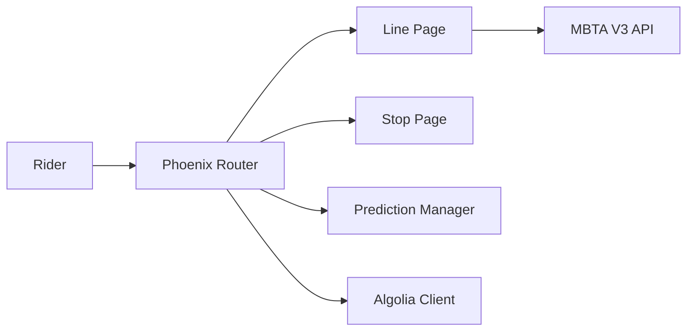

# mbta/dotcom

> Code of the MBTA's (Boston transit) public website, for its developers.

## The problem
Riders need schedules, stops, fares and real-time predictions in a single web interface.

## What it actually does
Elixir/Phoenix application: router, line pages, stop pages, schedules, a trip planner (OpenTripPlanner), a support form. It reads the MBTA V3 API, a CMS and Algolia for search. Predictions arrive in real time through PubSub. The interface comes in 6 languages with Gettext and Smartling translation.

## How it is wired


## Trying it
```bash
asdf install
mix deps.get
npm run install
cp .env.template .env
docker run --rm -p 6379:6379 redis:7.2.4
iex -S mix phx.server
```

## Cost and gotchas
An MBTA V3 API key must be requested, a Redis instance is required, and Algolia is used for search (`mix algolia.update`). Installed through Homebrew and asdf, designed for macOS.

## What it is not
Not reusable elsewhere: it is coupled to the MBTA's API and CMS.

## Alternatives
None cited in the README.

## For you
Ignore: an Elixir site specific to one operator, unrelated to data, AI or MLOps, except as a reference for Artillery load tests.
