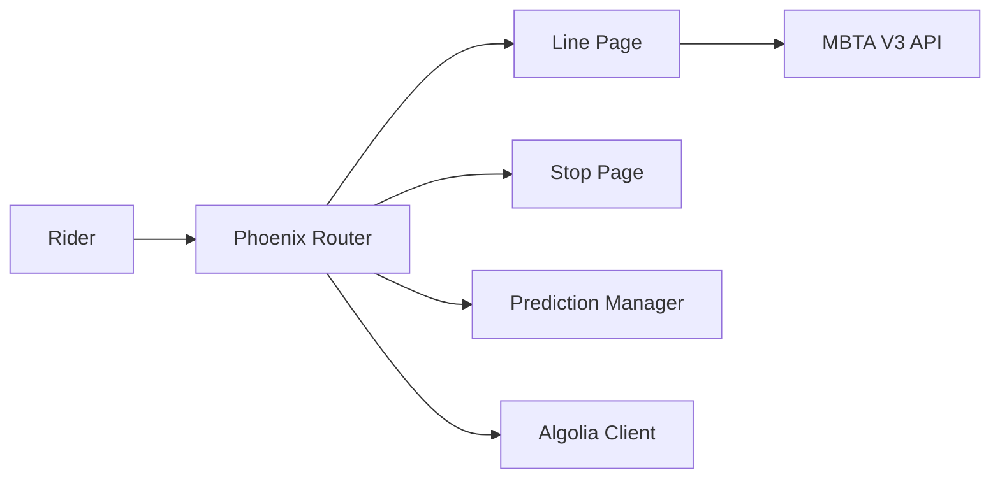

# mbta/dotcom

> Code du site web public de la MBTA (transports de Boston), pour ses développeurs.

## Le problème
Les voyageurs ont besoin d'horaires, d'arrêts, de tarifs et de prévisions en temps réel sur une interface web unique.

## Ce que ça fait vraiment
Application Elixir/Phoenix : routeur, pages ligne, arrêt, horaires, planificateur d'itinéraire (OpenTripPlanner), formulaire de support. Elle lit l'API MBTA V3, un CMS et Algolia pour la recherche. Les prédictions arrivent en temps réel via PubSub. Interface en 6 langues avec Gettext et traduction Smartling.

## Comment c'est branché


## Essayer
```bash
asdf install
mix deps.get
npm run install
cp .env.template .env
docker run --rm -p 6379:6379 redis:7.2.4
iex -S mix phx.server
```

## Coût et pièges
Clé API MBTA V3 à demander, instance Redis requise, Algolia pour la recherche (`mix algolia.update`). Install via Homebrew et asdf, pensée pour macOS.

## Ce que ce n'est pas
Pas réutilisable ailleurs : couplé à l'API et au CMS de la MBTA.

## Alternatives
Aucune citée dans le README.

## Pour toi
Ignorer : un site Elixir propre à un opérateur, sans lien avec data, IA ou MLOps, sauf comme référence de tests de charge Artillery.

