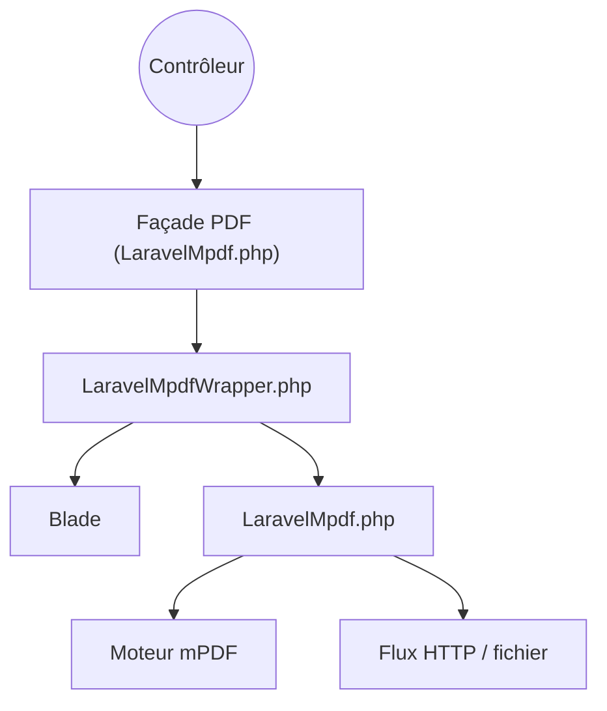

# mccarlosen/laravel-mpdf

> Laravel package that generates PDFs from Blade views using the mPDF library.

## The problem
Producing a PDF from a Blade template without coding the mPDF integration yourself.

## What it actually does
A `PDF` facade loads a view, raw HTML or a file; the constructor merges `config/pdf.php` with one-off overrides, configures mPDF and outputs the PDF as a string, file, download or stream. Handles headers and footers, custom fonts, watermarks, and chunking of large HTML (`chunkLoadView`).

## How it is wired


## Trying it
```bash
composer require carlos-meneses/laravel-mpdf
php artisan vendor:publish --tag=mpdf-config
```

## Cost and gotchas
Requires PHP and Laravel (tested from Laravel 5.4). mPDF exceeds the time limit on a single-threaded server (`artisan serve`). No licence declared, last push in November 2024.

## What it is not
Not a business-intelligence report generator: an HTML-to-PDF converter.

## Alternatives
No alternative named in the README.

## For you
Ignore: Laravel-specific, with no clear licence and little activity.
