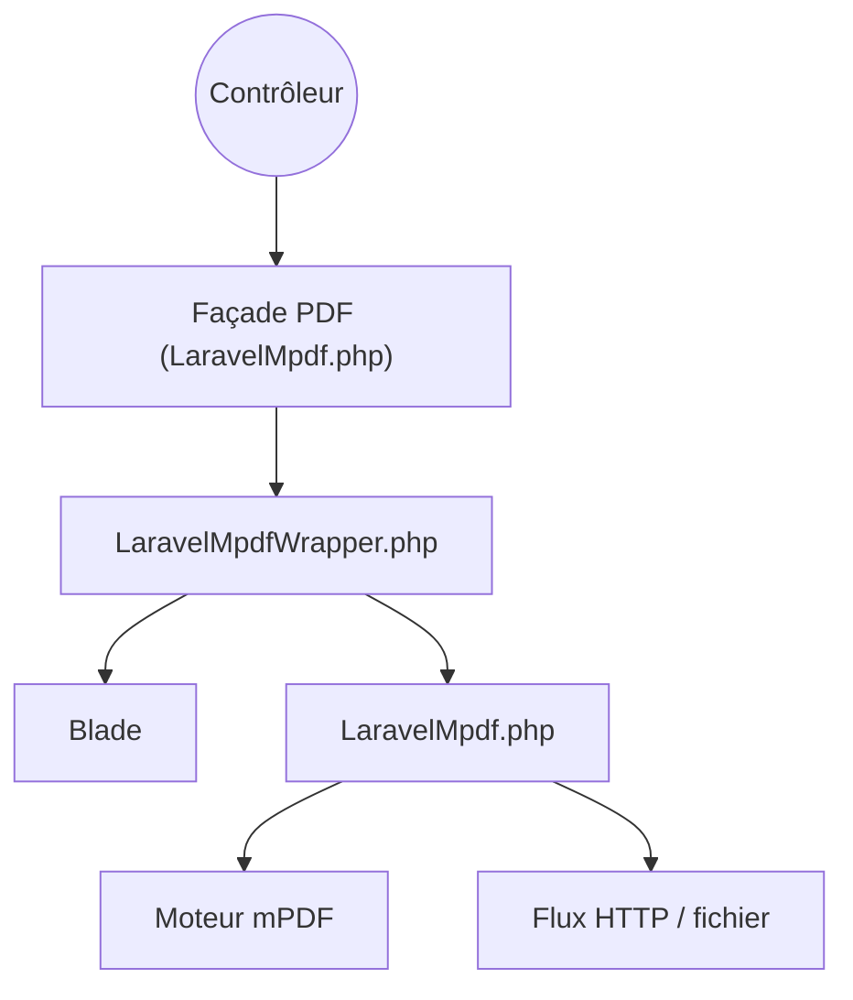

# mccarlosen/laravel-mpdf

> Paquet Laravel qui génère des PDF depuis des vues Blade avec la bibliothèque mPDF.

## Le problème
Produire un PDF à partir d'un modèle Blade sans coder soi-même l'intégration de mPDF.

## Ce que ça fait vraiment
Une façade `PDF` charge une vue, du HTML brut ou un fichier ; le constructeur fusionne `config/pdf.php` et les surcharges ponctuelles, configure mPDF et sort le PDF en chaîne, fichier, téléchargement ou flux. Gère en-têtes et pieds de page, polices personnalisées, filigranes, et un découpage du HTML volumineux (`chunkLoadView`).

## Comment c'est branché


## Essayer
```bash
composer require carlos-meneses/laravel-mpdf
php artisan vendor:publish --tag=mpdf-config
```

## Coût et pièges
Nécessite PHP et Laravel (testé depuis Laravel 5.4). mPDF dépasse le temps imparti sur un serveur mono-thread (`artisan serve`). Aucune licence déclarée, dernier push en novembre 2024.

## Ce que ce n'est pas
Pas un générateur de rapports décisionnels : un convertisseur HTML vers PDF.

## Alternatives
Aucune alternative nommée dans le README.

## Pour toi
Ignorer : spécifique à Laravel, sans licence claire et peu actif.

