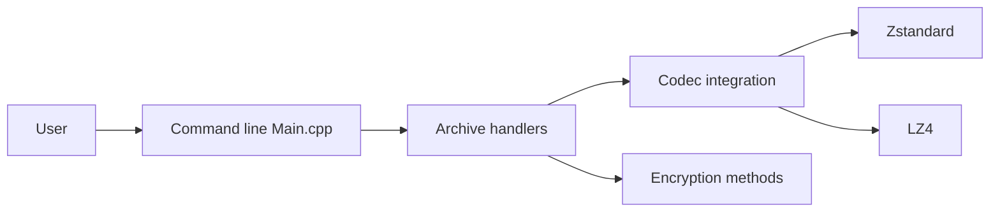

# mcmilk/7-Zip-zstd

> Fork of 7-Zip that adds the Zstandard, Brotli, LZ4, Lizard codecs and modern encryption.

## The problem
The official 7-Zip neither reads nor writes Zstandard, Brotli or LZ4 archives natively, which are common in datasets and builds.

## What it actually does
It adds codecs, hash functions (BLAKE3, XXH64...) and ciphers (XChaCha20, cascades with Ascon or AEGIS). Full installation with interface, or simple codec plugin for an existing 7-Zip. Command-line variants `7z`, `7zz`, `7za`, `7zr`.

## How it is wired


## Trying it
```bash
7z a archiv.7z -m0=zstd -mx1
7z x -so test.tar.zst | 7z l -si -ttar
7z a archive.7z -ppassword -mhe=on -mem=xchacha20poly1305
7z.exe i
```

## Cost and gotchas
Free. The license is present but not identified by GitHub. Antivirus software reports false positives; the installer is not yet signed.

## What it is not
Not the official 7-Zip: the author says its inclusion in the main version was refused. Archives created with these codecs cannot be opened with a standard 7-Zip.

## Alternatives
- p7zip: version for Linux and macOS with LZ4 and Zstandard.

## For you
Keep an eye on it: handy for compressing datasets and artifacts with Zstandard on Windows, with the risk of formats unreadable elsewhere.
