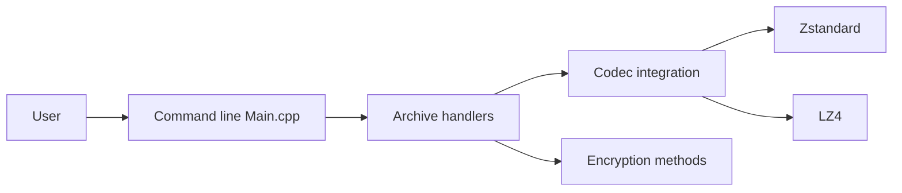

# mcmilk/7-Zip-zstd

> Fork de 7-Zip qui ajoute les codecs Zstandard, Brotli, LZ4, Lizard et des chiffrements modernes.

## Le problème
Le 7-Zip officiel ne lit ni n'écrit nativement les archives Zstandard, Brotli ou LZ4, courantes dans les jeux de données et les builds.

## Ce que ça fait vraiment
Il ajoute des codecs, des fonctions de hachage (BLAKE3, XXH64…) et des chiffrements (XChaCha20, cascades avec Ascon ou AEGIS). Installation complète avec interface, ou simple plugin de codecs pour un 7-Zip existant. Variantes en ligne de commande `7z`, `7zz`, `7za`, `7zr`.

## Comment c'est branché


## Essayer
```bash
7z a archiv.7z -m0=zstd -mx1
7z x -so test.tar.zst | 7z l -si -ttar
7z a archive.7z -ppassword -mhe=on -mem=xchacha20poly1305
7z.exe i
```

## Coût et pièges
Gratuit. La licence est présente mais non identifiée par GitHub. Des antivirus signalent de faux positifs ; l'installeur n'est pas encore signé.

## Ce que ce n'est pas
Ce n'est pas le 7-Zip officiel : l'auteur dit que son inclusion dans la version principale a été refusée. Les archives créées avec ces codecs ne s'ouvrent pas avec un 7-Zip standard.

## Alternatives
- p7zip : version pour Linux et macOS avec LZ4 et Zstandard.

## Pour toi
À surveiller : pratique pour compresser jeux de données et artefacts en Zstandard sous Windows, avec le risque de formats non lisibles ailleurs.

