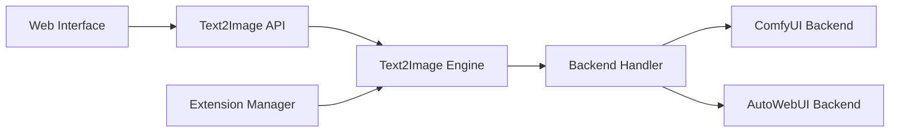

# mcmonkeyprojects/SwarmUI

> Modular web interface for image, video and audio generation, with a ComfyUI workflow tab.

## The problem
Generating images/video with diffusion requires scattered tools; you need a UI that is both simple and powerful.

## What it actually does
ASP.NET server (.NET 8) with a Generate tab, an image editor, a grid generator and a Comfy Workflow tab. It drives ComfyUI backends (installed automatically) or AUTOMATIC1111, can spread the work over several GPUs, and handles extensions, models and an API. Status "Almost-Release" (v0.9.8 Beta).

## How it is wired


## Trying it
```bash
git clone https://github.com/mcmonkeyprojects/SwarmUI
cd SwarmUI
./launch-linux.sh
```

## Cost and gotchas
Free, but you need a GPU and large model downloads. Python 3.10–3.12; do not use 3.14+. Mac: Apple Silicon only. Legal note: some optional components (ultralytics AGPL, ComfyUI GPL) may impose their terms.

## What it is not
Not a model: an interface. The licenses of the models used remain to be checked; native LLM assistance is not there yet.

## Alternatives
AUTOMATIC1111/stable-diffusion-webui (cited as a backend) and ComfyUI (also a backend).

## For you
Adopt it if you have a GPU and want to experiment with image generation: MIT, very active, direct access to ComfyUI workflows.
