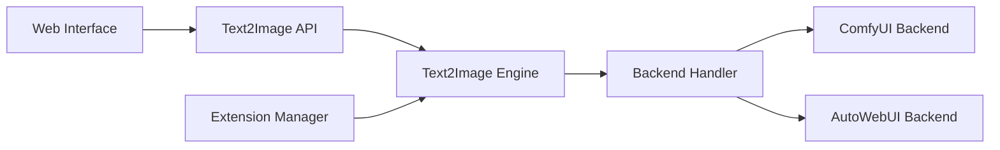

# mcmonkeyprojects/SwarmUI

> Interface web modulaire de génération d'images, vidéo et audio, avec onglet de workflow ComfyUI.

## Le problème
Générer des images/vidéos avec diffusion demande des outils épars ; il faut une UI à la fois simple et puissante.

## Ce que ça fait vraiment
Serveur ASP.NET (.NET 8) avec onglet Generate, éditeur d'image, générateur de grilles et onglet Comfy Workflow. Il pilote des backends ComfyUI (installé automatiquement) ou AUTOMATIC1111, peut répartir le travail sur plusieurs GPU, gère extensions, modèles et API. Statut « Almost-Release » (v0.9.8 Beta).

## Comment c'est branché


## Essayer
```bash
git clone https://github.com/mcmonkeyprojects/SwarmUI
cd SwarmUI
./launch-linux.sh
```

## Coût et pièges
Gratuit, mais GPU et téléchargement de modèles (volumineux). Python 3.10–3.12 ; ne pas utiliser 3.14+. Mac : Apple Silicon seulement. Mention légale : certains composants optionnels (ultralytics AGPL, ComfyUI GPL) peuvent imposer leurs termes.

## Ce que ce n'est pas
Pas un modèle : une interface. Les licences des modèles utilisés restent à vérifier ; l'assistance LLM native n'est pas encore là.

## Alternatives
AUTOMATIC1111/stable-diffusion-webui (cité comme backend) et ComfyUI (backend aussi).

## Pour toi
À adopter si tu as un GPU et veux expérimenter la génération d'images : MIT, très actif, accès direct aux workflows ComfyUI.

