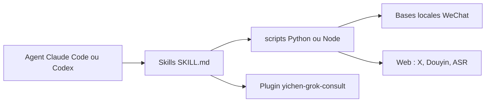

# mcncarl/yichen-skills

> Twenty content-creator skills: X, WeChat, Douyin, ASR, web search, agent memory.

## The problem
A Chinese or bilingual creator manually chains publishing on X, archiving content, transcription and use of their WeChat data.

## What it actually does
Skills to upload X article drafts, read and decrypt local WeChat/WeCom databases, archive Douyin and Xiaohongshu, transcribe (Volcengine ASR), route multi-source searches, consult Grok, slice an X post into a video, and drive ChatGPT Pro for review while Codex alone writes. Many documented safeguards: explicit authorization, no control of the WeChat interface, no token in the repository.

## How it is wired


## Trying it
```bash
npx skills add mcncarl/yichen-skills --skill yichen-x-slicer
pip install pycryptodome zstandard
codex plugin marketplace add mcncarl/yichen-skills --ref main
codex plugin add yichen-grok-consult@yichen-skills
```

## Cost and gotchas
Per-skill dependencies (Playwright, ffmpeg, Grok CLI, frida for key extraction). Third-party services (Volcengine, Firecrawl, xAI) are billed to you. The WeChat skills decrypt messaging data: strictly personal use.

## What it is not
Not free for commercial use: the README limits use to personal non-commercial, with written authorization and a link to a paid community. License not identified by GitHub: to be verified. Several skills are macOS-only.

## Alternatives
No alternative named in the README.

## For you
Worth watching: interesting mainly for its safeguard model; the ban on commercial use and the WeChat/X-centered content make it poorly suited to a corporate context.
