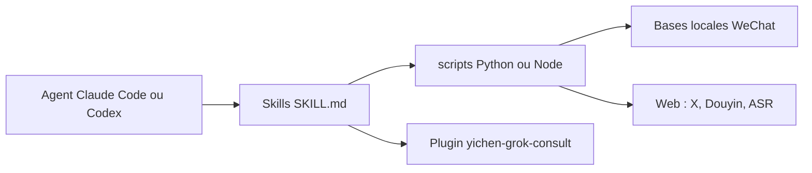

# mcncarl/yichen-skills

> Vingt skills de créateur de contenu : X, WeChat, Douyin, ASR, recherche web, mémoire d'agent.

## Le problème
Un créateur chinois ou bilingue enchaîne à la main publication sur X, archivage de contenus, transcription et exploitation de ses données WeChat.

## Ce que ça fait vraiment
Skills pour téléverser des brouillons d'articles X, lire et déchiffrer des bases locales WeChat/WeCom, archiver Douyin et Xiaohongshu, transcrire (Volcengine ASR), router des recherches multi-sources, consulter Grok, découper un post X en vidéo, et piloter ChatGPT Pro pour la revue pendant que Codex seul écrit. Beaucoup de garde-fous documentés : autorisation explicite, pas de contrôle de l'interface WeChat, aucun jeton dans le dépôt.

## Comment c'est branché


## Essayer
```bash
npx skills add mcncarl/yichen-skills --skill yichen-x-slicer
pip install pycryptodome zstandard
codex plugin marketplace add mcncarl/yichen-skills --ref main
codex plugin add yichen-grok-consult@yichen-skills
```

## Coût et pièges
Dépendances par skill (Playwright, ffmpeg, Grok CLI, frida pour l'extraction de clés). Les services tiers (Volcengine, Firecrawl, xAI) sont facturés à ta charge. Les skills WeChat décryptent des données de messagerie : usage strictement personnel.

## Ce que ce n'est pas
Pas libre d'usage commercial : le README limite l'usage au personnel non commercial, avec autorisation écrite et lien vers une communauté payante. Licence non identifiée par GitHub : à vérifier. Plusieurs skills sont réservés à macOS.

## Alternatives
Aucune alternative nommée dans le README.

## Pour toi
À surveiller : intéressant surtout pour son modèle de garde-fous ; l'interdiction d'usage commercial et le contenu centré WeChat/X le rendent peu adapté à un contexte entreprise.

