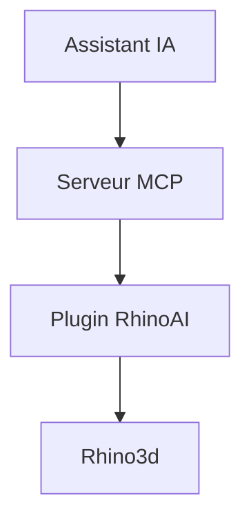

# mcneel/RhinoAI

> Integration of AI assistants into the Rhino 3D modeling software, via an MCP server, for Rhino users.

## The problem
Driving Rhino in natural language requires a bridge between the AI assistant and the software.

## What it actually does
A Rhino plugin that exposes an MCP server. The assistants cited are Claude Desktop, Claude Code, GitHub Copilot, OpenAI Codex, Gemini CLI or a local model. The README details nothing else: the content is in the external documentation.

## How it is wired
Simplified diagram based on the fiche, no diagram provided.

## Trying it
No command documented: the fastest path is the Rhino3d connector of Claude Desktop (see mcneel.github.io/RhinoAI).

## Cost and gotchas
Free (MIT), but Rhino is commercial software and you need an AI assistant. The possible model cost is not documented. Very short README.

## What it is not
Not a standalone tool: without Rhino or an assistant, it does nothing. The README does not say what the plugin can do.

## Alternatives
No alternative named in the README.

## For you
Ignore: reserved for Rhino users, and the README does not allow further evaluation.
