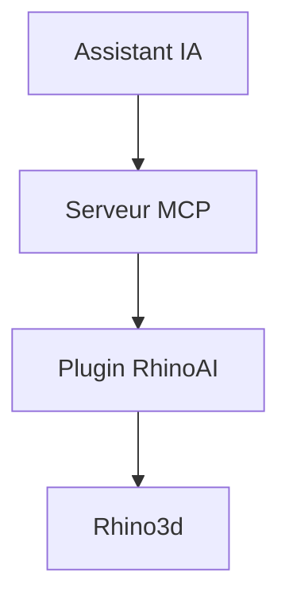

# mcneel/RhinoAI

> Intégration d'assistants IA au logiciel de modélisation 3D Rhino, via un serveur MCP, pour les utilisateurs de Rhino.

## Le problème
Piloter Rhino en langage naturel demande un pont entre l'assistant IA et le logiciel.

## Ce que ça fait vraiment
Un plugin Rhino qui expose un serveur MCP. Les assistants cités sont Claude Desktop, Claude Code, GitHub Copilot, OpenAI Codex, Gemini CLI ou un modèle local. Le README ne détaille rien d'autre : le contenu est dans la documentation externe.

## Comment c'est branché
Schéma simplifié d'après la fiche, sans diagramme fourni.

## Essayer
Aucune commande documentée : le chemin le plus rapide est le connecteur Rhino3d de Claude Desktop (voir mcneel.github.io/RhinoAI).

## Coût et pièges
Gratuit (MIT), mais Rhino est un logiciel commercial et il faut un assistant IA. Le coût éventuel du modèle n'est pas documenté. README très court.

## Ce que ce n'est pas
Pas un outil autonome : sans Rhino ni assistant, il ne fait rien. Le README ne dit pas ce que le plugin sait faire.

## Alternatives
Aucune alternative nommée dans le README.

## Pour toi
À ignorer : réservé aux utilisateurs de Rhino, et le README ne permet pas d'évaluer plus.

