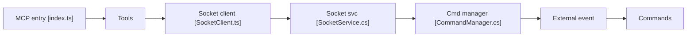

# mcp-servers-for-revit/mcp-servers-for-revit

> Serveur MCP qui permet à Claude ou Cline de lire et modifier des projets Autodesk Revit.

## Le problème
Un assistant IA ne peut pas agir sur un modèle Revit : l'API de Revit est fermée et mono-thread.

## Ce que ça fait vraiment
Trois étages : un serveur MCP TypeScript (stdio côté client), un add-in C# dans Revit relié par WebSocket, et un jeu de commandes C# qui exécute les opérations de l'API Revit (niveaux, pièces, cotations, extraction de quantités, suppression). Une base locale conserve des données de projet pour les outils `store_*`. C'est un fork de revit-mcp.

## Comment c'est branché


## Essayer
```bash
claude mcp add mcp-server-for-revit -- cmd /c npx -y mcp-server-for-revit
```

## Coût et pièges
Il faut Autodesk Revit 2020 à 2026, sous licence, donc Windows et payant. Node 18+ pour le serveur. L'add-in se copie à la main dans le dossier Addins. Les tests tournent contre un Revit réel.

## Ce que ce n'est pas
Pas un outil indépendant de Revit, ni un simple convertisseur de fichiers. Il agit sur le modèle ouvert, avec le risque de modification ou de suppression d'éléments.

## Alternatives
- revit-mcp (projet d'origine dont celui-ci est un fork).

## Pour toi
Surveiller : sans Revit il est inutile, mais c'est un bon exemple d'architecture MCP avec pont WebSocket vers une application métier.

