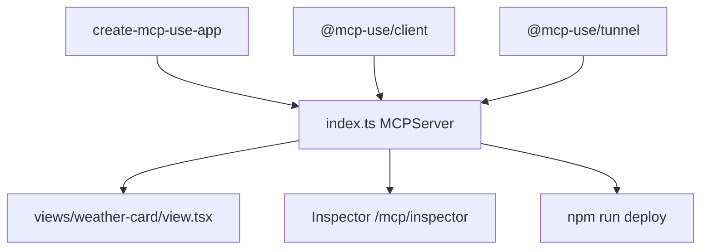

# mcp-use/mcp-use

> TypeScript framework to build, test and deploy MCP servers with built-in React interfaces.

## The problem
Writing an MCP server by hand requires wiring: schemas, transport, inspection, a visual interface, a tunnel to test with ChatGPT or Claude.

## What it actually does
You declare typed tools with zod (`server.tool`), optionally tied to a React view (`views/<name>/view.tsx`). The project provides a local Inspector, a CLI client, a screenshot of the views, a public tunnel and a deploy command to the Manufact platform.

## How it is wired


## Trying it
```bash
npx -y create-mcp-use-app@latest
npm run dev
npm run build
npx mcp-use client connect local http://localhost:3000/mcp
npx mcp-use client local tools list
npm run deploy
```

## Cost and gotchas
Free locally. Managed deployment goes through Manufact (announced as free for basic observability); self-hosting is documented. A v1 to v2 migration is to be expected.

## What it is not
Not a full LLM client: the agent is a separate package. The benchmark figures in the README come from the author.

## Alternatives
FastMCP TS, official SDK v2, xmcp, Skybridge, mcp-handler (compared in the README).

## For you
Worth watching: useful if you expose data tools to an agent with an interface, but the gain comes from TypeScript and the views, not from the MCP core.
